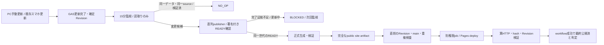

# 自動検知・検証・Pages公開（未有効化）

## 現状と判定

統合基準はmain `799da39fea89545c4471a45cef87c42c5cd165b7`。Draft PR #1の正式生成候補とSTEP11-B/Cの確定差分を別候補へ取り込む。正式生成の実測はrun 44503302558とSTEP11-A/Bを参照する。

現行PagesはGitHub Actions配信。固定版7,637件は移行run 44870873340で検証済み。移行workflow・必須CI・初回署名workflowの配置と挙動を維持する。

**本番有効化はBLOCKED。** 管理GAS v27、公開API v66。初回署名run 44875924531は1 POSTでREADYを確認し、試験鍵を失効済み。受理・送信・公開はOFF。安定したRevisionは完了証拠の代用に使わない。

## PC・スマホの確定経路

保存済み・読取り照合済み管理GAS v26では、PC `updateAll()` → `runDatabaseUpdateWithLock_({source:"pc"})` → `executeDatabaseUpdateCore_()`。スマホの既存ジョブも同じScript Lockと共通更新本体へ合流する。

全更新step成功後だけ`finalizePublishedDatabaseUpdateRawV490_()`が共有dataRevisionを確定する。しかし更新ログの記録はその後で、ログ記録失敗なら全体結果はfailedになる。したがって「新しいRevisionが見えた」だけでは「すべて更新の正常完了」を証明できない。管理側のgetAdminUpdateStatusは認証された別プロジェクトの状態で、公開APIから取得できるとは仮定しない。PCセル編集の自動実行、updateAll本体、スマホの書込経路は変更していない。

## 構成

`.github/workflow-templates/`は非稼働の保管場所。scheduleも公開workflowも現在の`.github/workflows/`へ設置していない。`tools/auto-sync/config.json`のenabled=falseとrepository variable未有効化の二重停止も維持する。

### 監視

- `.github/workflow-templates/auto-sync-revision-monitor.yml` は毎時7/22/37/52分（UTC）にrevisionをGETし、現行公開の両Revisionとsource fingerprintを比較する。監視にはSecretが不要。同一ならNO_OP、初回・変更時は未署名のCHECKを記録する。`auto-sync-monitor.yml` は使用済みの初回署名試験専用。
- publisherはGitHub実行情報、計画のSHA256、main、fingerprint、両Revisionを照合し、保護された署名ステップでv66の既存 `build-start` を使う。同一世代のREADYが成立した場合だけ、現在のpublisher runに結び付けたBUILD計画を作る。artifactには完了世代IDのSHA256だけを保存する。
- 実ドメインのcurrent、snapshot manifest、小さい公開receipt、および対応するGitHub runの成功を確認する。Git mainのcurrentはartifact公開後に古くなり得るため最終公開済の正本にはしない。
- source fingerprintはWeb/renderer/生成コード・sidecar・workflow・lockfileを含み、生成snapshot/current/gapは除外する。データ更新による自己再生成ループを避け、Webコードだけの変更も検出する。
- 監視自体は全件API・Chrome・generatorを起動しない。変更なしはNO_OP。初回のreceiptなしはbootstrapであり、未確認を「公開済の同一source」にしない。
- 失敗したpublisherは同じmain HEADで無条件に再実行しない。監視から失敗run IDを明示承認して再試験する。run中に新Revisionへ変わった場合は公開せずsupersededとし、次の監視で最新を再検出する。

### 生成・検証

- 新しいデータ世代は既存正式generatorに`--event-transport=batch-v1 --event-batch-size=8`を明示する。通常の手動generatorはlegacyのまま。
- 既に公開されている同一世代のJSONは、公開file manifestのbytes/hashで検証して保持する。同一世代のWeb再構築は既存Song/Release正式producerで231ページをcaptureし、JSONを再生成して同じRevision URLのbytesを変えない。
- 新世代のEvent件数・歌唱行数は取得結果から独立集計する。357件/1,415行は検証済み基準であり、今後の新規イベント追加を永久に拒否する固定値にしない。Song117/Release114、両経路の歌唱行多重集合、ID/順序、既存Eventの欠落は厳密に検査する。
- 既存の固定データ向け回帰は取得済みの不変baselineに対して生成前に実行。生成した新世代は独立validator/参照・多重集合検査、実画面4条件で検証する。成功済みassertやgolden hashは変更しない。
- 実Chrome158 / Playwright1.62.1 / Node24.19.0 / 日本語fontを既存CI同様に固定。capture231、verified switch追加0、canonical全231件、validator/integrity PASS、provenance VERIFIEDが必須。
- gap/share/sitemapは生成後にcheckも実行する。生成前後・公開直前・公開後に両Revisionと完了世代IDを照合する。
- 音源JSON・クレジット等を含むsource fingerprint不変を確認。Pages siteには通常のpublic出力と、`public-card-tools.json` の完全一致42件を入れる。ほかの開発用ファイル、GAS、非公開入力、生HTTPは除外する。

### 同時実行と失敗

監視は軽量の独立workflow。publisher全体を`musdb-pages-production`という1つのconcurrency groupで直列化し、cancel-in-progress=falseにする。監視のpendingが置換・遅延しても、次回は実公開状態と最新Revisionを再比較する。キュー順を正しさの根拠にしない。

新しい公開jobはcontents/actions readにpages write / id-token writeだけを追加する。アップロード直後の再署名とPages実行を同じjobに留めるため、主ブランチ限定の `musdb-sync-signing` を使用する。署名鍵は署名ステップだけが参照し、既存の `github-pages` と固定版移行workflowの設定は維持する。初回公開前に、このEnvironmentでのPages OIDC経路と保護設定を別承認で確認する。手動の固定版配信は自動publisherと同時に実行しない。

Pages artifactのアップロード後、署名POSTで両Revisionと完了世代を再照合する。最終照合後からPages反映までにGAS更新が始まる余地がある。公開後も署名で世代を確認し、不一致は公開完了の記録を止めてfailedにする。復旧は別承認とし、検証済公開には対応workflowの成功を要求する。

## 状態とスマホ向け接続

- `state.json`/`state-history.jsonl`とGitHub job/stepからwaiting/generating/validating/deploying/published/failed/supersededを取得できる。
- 実公開`data/sync-release.json`にはRevision、source SHA/fingerprint、run URL、file manifest hash、前回の検証済receiptを保存する。これはdeployed candidateの識別情報で、記載だけで成功とはしない。対応GitHub workflow成功とHTTP検証が必要。
- `data/sync-files.json`は全publicファイルのbytes/hash。前回snapshotを公開CDNから検証して引き継げるため、GitHub artifact期限切れを通常更新の必須障害にしない。既存snapshotを自動削除しない。siteが保守的な900MiB上限を超える場合は公開停止し、別途承認した保存方針を決める。
- 将来のスマホ画面は公開revision/readiness、実site receipt、GitHub runから`publicState()`の形式へ集約する。GAS更新成功/API反映とPages公開成功を別表示する。現行管理UIの「Web反映」はPublic API一致の意味であり、今回は修正していない。
- ブラウザにGitHub tokenを埋め込まない。公開runのリンク表示を基本とし、必要なら管理側の認証済read-only集約・cacheを別承認で追加する。取得不可はunknownで、0件や成功にはしない。

## 運用・有効化

1. 統合Draft PRの必須CIとread-only safety試験を確認する。mainへのマージは別承認。
2. 既存の固定版7,637件の復旧ZIP・台帳を再照合する。署名Environmentのmain限定、Pages OIDC、鍵・nonce台帳の有効化および失効手順を別承認で確定する。
3. 監視・publisherの設置は初回手動試験用とし、scheduleは保留する。`enabled`、`signedReadiness.enabled`、対応変数、GAS受付、試験鍵の登録にはそれぞれ承認が必要。
4. 初回は確認付きでbootstrap→HTTP検証まで実施する。同一Revisionは既存公開snapshotのバイトを保持する。合格後に限りscheduleを別承認で有効化する。

15分は検知間隔であり完了保証ではない。AUTO-SYNC-12の実測はjob約21分22秒、正式生成＋capture約17分14秒。通常の反映目安は更新完了から約20〜40分＋キュー/ネットワーク時間。生成中の再更新、CDN、schedule遅延・欠落、公開repoの長期無活動によるschedule停止があればさらに遅れる。96回/日の監視はNO_OP中心とし、生成は必要時だけ。

## 復旧・通知

- 生成/検証失敗ではPages artifactを公開しない。siteの部分公開は行わず、証拠を保存する。
- 公開前にsupersededなら次回監視へ。実API/Chrome/validatorの異常は失敗run IDを記録して、原因確認・明示的な再実行承認を待つ。
- deploy/公開後QA失敗では自動rollbackや再pushをしない。先にschedule/variableを停止する操作の承認を得て、前回verified runのsite artifact（または保存済みsite）とhashを検証し、承認後に同じPages deployment方式で復旧し、実HTTP確認する。GAS/RAW/Revisionを巻き戻さない。
- artifactは14日保管のテンプレート。重要な初回・last-known-good siteは別途承認した長期保存が必要。期限切れ時に不明なsiteを復旧元にしない。
- GitHub標準の失敗通知・Actions summary/runリンクを推奨。通知設定、メール/外部サービス追加、実通知送信は今回は行わない。

## 残る実環境試験

新workflowのPR/Actions実行、readiness bridge実HTTP、Pages source切替/OIDC deploy/実CDN後検証は未実施。AUTO-SYNC-11のGoogleサーバー故障注入（途中Revision変更・強制部分応答・45秒/512KiB超過）も未実施のまま。mock/local負例PASSで代替しない。

公式仕様：
- [Custom Pages workflows / Pages artifact・権限](https://docs.github.com/en/pages/getting-started-with-github-pages/using-custom-workflows-with-github-pages)
- [Publishing source / GITHUB_TOKEN pushとPages build](https://docs.github.com/en/pages/getting-started-with-github-pages/configuring-a-publishing-source-for-your-github-pages-site)
- [Scheduleの遅延・欠落・default branch制約](https://docs.github.com/en/actions/reference/workflows-and-actions/events-that-trigger-workflows#schedule)
- [Concurrencyとキュー制約](https://docs.github.com/en/actions/how-tos/write-workflows/choose-when-workflows-run/control-workflow-concurrency)
